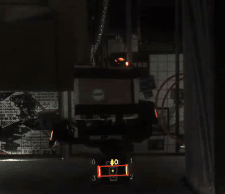

# RoboMaster 前哨站装甲板检测与位姿解算

用 C++17 和 OpenCV 检测前哨站的装甲板。程序从两根灯条提取有序四角点，再逐帧解算装甲板相对相机的位置和朝向。

[构建与运行](#构建与运行) · [检测与位姿流程](#从图像到位姿) · [验收材料](#第二阶段验收)

## 视频演示

[](output/result_preview.mp4)

| 材料 | 内容 |
| --- | --- |
| [预览视频](output/result_preview.mp4) | H.264，35 秒，5.2 MB |
| [完整标注视频](output/result.mp4) | 4210 帧，1280×1024，约 120 fps |
| [逐帧位姿 CSV](output/pose_log.csv) | 候选编号、检测和解算状态、位姿、距离与重投影误差 |

## 构建与运行

本项目在 Windows 上使用 **CLion、MinGW、CMake 3.16+ 和 OpenCV 4.12.0** 构建。视频读取优先使用 FFmpeg 后端。

1. 用 CLion 打开项目根目录，在 [CMakeLists.txt](CMakeLists.txt) 中把 `OpenCV_DIR` 指向本机的 OpenCV 安装目录。OpenCV 库应与项目使用的工具链匹配。
2. 在运行配置的 `PATH` 中加入 OpenCV DLL 和相应运行时库的目录。当前环境使用 `D:\opencv_work\build\install\x64\mingw\bin` 和 `D:\msys64\mingw64\bin`。
3. 构建后，从项目根目录运行。下例使用 CLion 的 `cmake-build-debug` 构建目录。

```powershell
# 静态图检测。弹窗获得焦点后按任意键结束
.\cmake-build-debug\armor_detector.exe images/outpost_frame.png

# 逐帧检测和位姿解算
.\cmake-build-debug\armor_detector.exe videos/outpost.avi
```

入口按小写 `.avi` 扩展名选择视频流程。省略参数时读取 `images/outpost_frame.png`。输出写到工作目录下的 `output/`。

## 从图像到位姿

| 阶段 | 当前实现 |
| --- | --- |
| 提取灯条 | 灰度化、模糊和亮度阈值生成掩膜，用竖向闭运算补断口，再按轮廓面积和长宽比筛选。HSV 色相辅助判断颜色。 |
| 构造候选 | 按颜色兼容、灯条长度、倾角、上下偏差和相对间距配对。用两根灯条的顶点求旋转外接矩形，再生成左上、右上、右下、左下四个角点。 |
| 逐帧解算 | 视频保留原始像素坐标。候选按中心 `x`、再按 `y` 排序并在帧内编号。角点有效时调用 `solvePnP()`。 |
| 核对与输出 | 用 `projectPoints()` 把四个模型点投回图像，取四组对应点的平均像素距离。逐帧写 CSV 和标注视频，按间隔保存验证图。 |

入口、检测、位姿解算和视频流程分别在 [main.cpp](main.cpp)、[detector.cpp](detector.cpp)、[pose.cpp](pose.cpp) 和 [video.cpp](video.cpp)。

## 坐标与输出

装甲板模型以板中心为原点，尺寸为 **0.135 m × 0.056 m**。模型四角顺序与检测一致。相机坐标系的 `x` 向右、`y` 向下、`z` 向前。当前相机参数对应原始的 `1280×1024` 视频帧。完整参数以 [pose.cpp](pose.cpp) 为准。

```text
K = [[1781.053454, 0, 510.5751561],
     [0, 1781.686873, 472.9735763],
     [0, 0, 1]]
D = [-0.04420740074, -0.1081537096, -0.0006506219039,
      0.0002357380215, 0.466737247]
```

- `tvec` 表示装甲板中心相对相机光心的三维位置，单位为米。`tz` 是沿光轴的深度，`distance` 是中心到光心的直线距离。
- `rvec` 是罗德里格斯旋转向量。向量方向表示旋转轴，模长表示旋转角，单位为弧度。
- `detect_valid` 表示角点是否可用，`pnp_valid` 表示是否得到有效位姿。一帧中每个候选各占一行，无候选帧也保留帧号和时间。无有效位姿时，CSV 的位姿和误差字段留空。

| 输出 | 用途 |
| --- | --- |
| [静态图结果](output/result.png)、[掩膜](output/target_mask.png)和[灯条图](output/lights.png) | 检查静态图的分割、配对和角点顺序 |
| `output/result.mp4` | MPEG-4 Part 2（`mp4v`）标注视频，显示帧号、候选编号、状态和距离 |
| `output/pose_log.csv` | 按帧复核有效状态、位置、朝向和平均重投影误差 |
| `output/reproject_*.png` | 对照检测角点（红色实心点）和重投影角点（绿色空心圈） |

## 第二阶段验收

指定视频共 **4210 帧**，其中 **1719 帧**检出候选。对这些候选的 PnP 解算成功 **1719 次**、失败 **0 次**。完整标注视频可以解码全部 4210 帧，分辨率为 **1280×1024**，帧率约 **119.998 fps**。

角点横移 2 像素的实验中，有两帧的重投影误差变小，深度仍偏移约 2.5 cm。复核深度时还要结合角点质量和成像条件。固定阈值和双灯条配对会受到光照、侧视和遮挡影响。

- [第二阶段验收记录](docs/验收记录.md)包含五帧重投影验证、三帧深度核对、敏感性实验、可信度判据和回归结果。
- [问题记录](docs/问题记录.md)汇总两阶段的故障现象、排查过程和修复结果。
- [第一阶段测试截图](docs/问题记录.md#第一阶段测试截图)记录静态图正常运行、无候选和读图失败。
